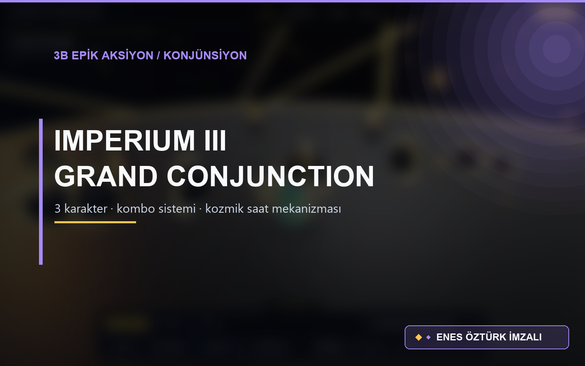
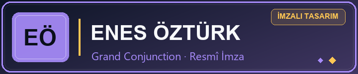
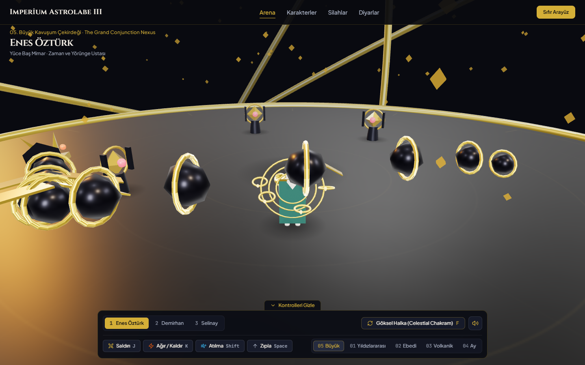
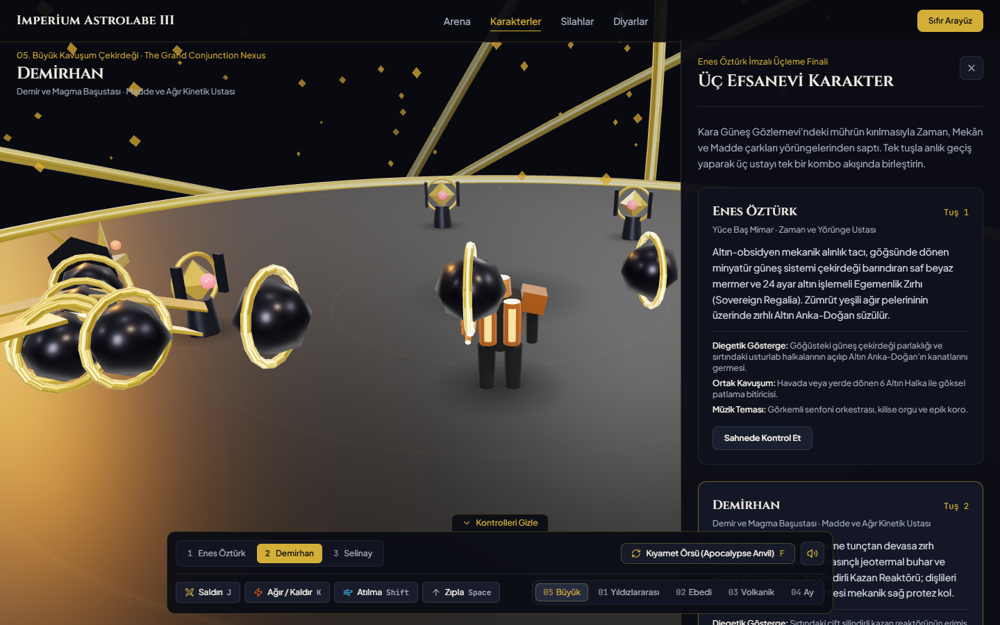
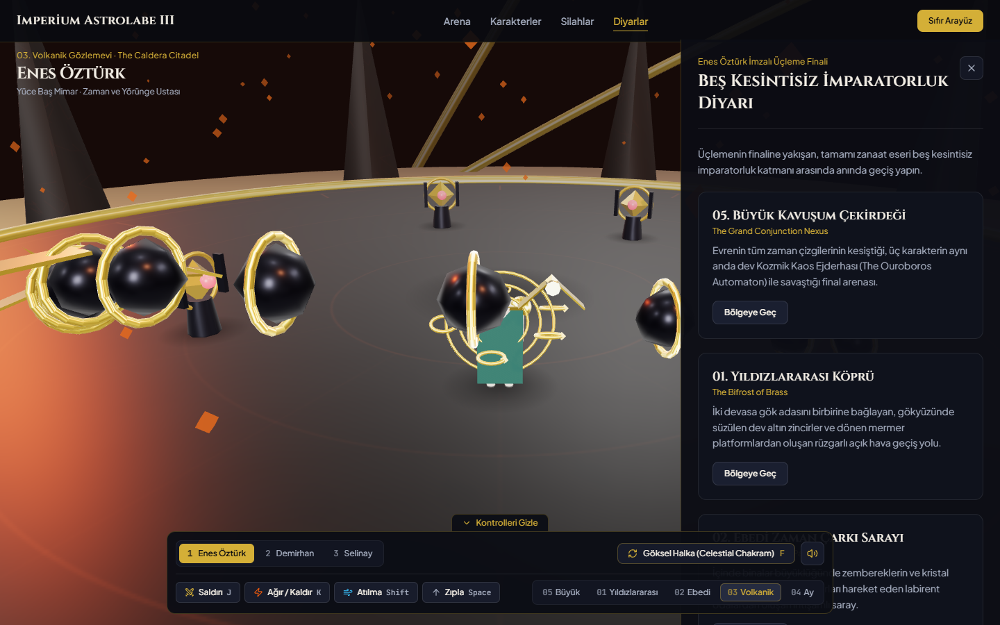

<div align="center">



# Imperium Astrolabe III: The Grand Conjunction

**Enes Öztürk imzalı, üç oynanabilir karakteri ve gerçek zamanlı geçişli kombo sistemi olan epik siber-barok 3D aksiyon.**

[](https://github.com/EnesBinMalik/imperium-astrolabe-iii-grand-conjunction)
[](https://react.dev/)
[](https://www.typescriptlang.org/)
[](https://threejs.org/)
[](https://vite.dev/)

[](https://github.com/EnesBinMalik)
[](https://github.com/EnesBinMalik/imperium-astrolabe-iii-grand-conjunction)
[](https://github.com/EnesBinMalik/imperium-astrolabe-iii-grand-conjunction)
[](https://github.com/EnesBinMalik/imperium-astrolabe-iii-grand-conjunction)



</div>

---

## Hakkında

**Imperium Astrolabe III**, imparatorluğun kozmik saat mekanizmasının son kez hizalandığı Büyük Kavuşum'da geçer. Üç farklı savaşçıyı—Enes Öztürk, Demirhan ve Selinay—aynı anda kontrol edersiniz; `1`, `2`, `3` tuşlarıyla anında geçiş yapıp kombo zincirleri kurarsınız.

Her karakterin birincil ve ikincil silah formu, farklı ağırlık ve ritmi vardır. Beş diyarda göksel halka, kıyamet örsü ve prizma yelpazeleriyle savaşırken arena, karakterler, silahlar ve lore panelleri tek arayüzde toplanır. Tüm modeller ve dokular **Three.js** ile prosedürel olarak üretilmiştir.

> Bu proje **Enes Öztürk** tarafından tasarlanmış, geliştirilmiş ve imzalanmıştır.

---

## Öne çıkan özellikler

| Özellik | Açıklama |
| --- | --- |
| **3 oynanabilir karakter** | Enes Öztürk, Demirhan ve Selinay için ayrı silah ve hareket kitleri. |
| **Gerçek zamanlı geçiş** | `1`–`2`–`3` ile karakter değiştirip kombo zincirini sürdürme. |
| **Çift silah formu** | `F` ile birincil ve ikincil form arasında anlık dönüşüm. |
| **5 kozmik diyar** | Bifrost'tan Grand Conjunction Nexus'a uzanan epik arena serisi. |
| **Kod paneli** | Character, weapon ve realm lore'u tek ekranda inceleme. |
| **Sıfır arayüz modu** | Tüm HUD'u kapatıp sahnenin kendisini okuma. |
| **Senfonik olay sesi** | Her karakter ve diyar için ayrı akustik karakter. |
| **Prosedürel modeller** | Karakter, düşman ve realm builder'larıyla tamamen kodla üretim. |

---

## Karakterler ve diyarlar

| Karakter | Unvan | Silah |
| --- | --- | --- |
| Enes Öztürk | Yüce Baş Mimar | Göksel Halka / Güneş Mızrağı |
| Demirhan | Demir ve Magma Başustası | Kıyamet Örsü / Ejderha Topu |
| Selinay | Kristal ve Işık Rahibesi | Prizma Yelpazeleri / Işık Kırbacı |

Her bölge kendi fizik kuralları, ışıklandırması, dokusu ve akustik karakteriyle ayrı bir deneyim sunar.

---

## Kontroller

| Tuş | Aksiyon |
| --- | --- |
| `W` `A` `S` `D` | Hareket |
| `J` / `K` | Saldırı ve ağır saldırı |
| `F` | Silah formunu dönüştür |
| `1` / `2` / `3` | Karakter geçişi |
| `Shift` | Atılma |
| `Boşluk` | Zıplama |
| `Arena` / `Diyarlar` | Bölüm ve realm panelleri |
| `Sıfır Arayüz` | HUD'u gizle |

> Savaş sırasında arayüz tamamen kaldırılabilir: ekranda yalnızca dünya içi telemetri kalır.

---

## Galeri







---

## Kurulum

**Gereksinimler:** Node.js 20+ ve modern bir WebGL tarayıcı.

```bash
git clone https://github.com/EnesBinMalik/imperium-astrolabe-iii-grand-conjunction.git
cd imperium-astrolabe-iii-grand-conjunction
npm install
npm run dev
```

Uygulama varsayılan olarak `http://localhost:3000` adresinde açılır.

> Proje tarayıcıda tamamen istemci tarafında çalışır; harici motor veya API anahtarı gerekmez.

Diğer komutlar:

```bash
npm run build     # Üretim derlemesi (dist/)
npm run preview   # Derlemeyi yerelde önizle
npm run lint      # TypeScript tip kontrolü
```

---

## Teknik mimari

```text
src/components/ImperiumViewport.tsx  Three.js sahnesi ve savaş
src/three/characterBuilders.ts   Üç karakterin prosedürel modelleri
src/three/enemyBuilders.ts       Düşman modelleri
src/three/realmBuilders.ts       Beş diyarın mimarisi
src/three/proceduralTextures.ts  Kozmik dokular
src/audio/ImperiumAudioEngine.ts  Karakter bazlı ses sistemi
src/data/imperiumLore.ts         Karakter, silah ve diyar loru
```

---

## İmza

<div align="center">

[](https://github.com/EnesBinMalik)
[](https://github.com/EnesBinMalik)

**Bu kod, tasarım ve deneyim Enes Öztürk'ün kişisel imzasını taşır.**

© 2026 Enes Öztürk — Tüm hakları saklıdır.

</div>
